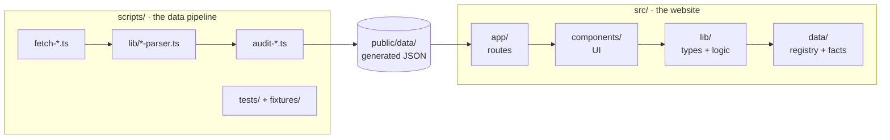
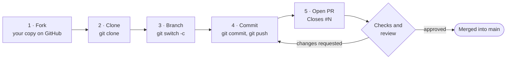
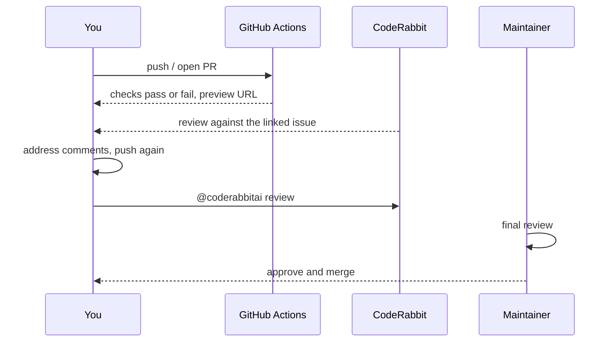

# Contributing to OSSGrid

Thanks for helping. This guide takes you from "I just opened the repo" to a merged pull request. You do not need to be an expert. Fixing a confusing sentence in these docs is a real contribution.

OSSGrid is maintained with one simple rule:

> **If you claim an issue, own it. Communicate early, ship it properly, and don't leave other contributors blocked.**

---

## Contents

1. [Ways to contribute](#1-ways-to-contribute)
2. [Find your way around](#2-find-your-way-around)
3. [Set up the project locally](#3-set-up-the-project-locally)
4. [Pick an issue](#4-pick-an-issue)
5. [The workflow: fork to pull request](#5-the-workflow-fork-to-pull-request)
6. [Working on different kinds of changes](#6-working-on-different-kinds-of-changes)
7. [Checks to run before you push](#7-checks-to-run-before-you-push)
8. [Opening and updating your pull request](#8-opening-and-updating-your-pull-request)
9. [Reporting bugs and wrong data](#9-reporting-bugs-and-wrong-data)
10. [Contributor rules](#10-contributor-rules)
11. [Best practices](#11-best-practices)
12. [Maintainer reference](#12-maintainer-reference)
13. [Getting help](#13-getting-help)

---

## 1. Ways to contribute

Code is only one way to help. Being new is useful: you notice the steps that experienced contributors skip.

| Type | Example | Where to start |
|---|---|---|
| Docs | Fix a typo, add a missing step, clarify a confusing line | Any `.md` file, or the [`documentation` label](https://github.com/rajatrsrivastav/ossgrid/issues?q=is%3Aissue+is%3Aopen+label%3Adocumentation) |
| Bug reports | A filter shows the wrong count, a page breaks on mobile | [Bug report form](https://github.com/rajatrsrivastav/ossgrid/issues/new/choose) |
| Data reports | An organization has the wrong website, a project is missing | [Wrong or missing data form](https://github.com/rajatrsrivastav/ossgrid/issues/new/choose) |
| Tests | Add a parser fixture or a test case for an untested function | `scripts/tests/` |
| UI fixes | Layout, accessibility, light or dark mode issues | [`bug` label](https://github.com/rajatrsrivastav/ossgrid/issues?q=is%3Aissue+is%3Aopen+label%3Abug) |
| Features | A new filter, a new program dashboard | [`enhancement` label](https://github.com/rajatrsrivastav/ossgrid/issues?q=is%3Aissue+is%3Aopen+label%3Aenhancement) |
| Reviews | Run someone else's PR preview and say what you saw | [Open pull requests](https://github.com/rajatrsrivastav/ossgrid/pulls) |

Please read the [Code of Conduct](./CODE_OF_CONDUCT.md) before you join a discussion.

---

## 2. Find your way around

### Read these first

| File | Tells you |
|---|---|
| [README.md](./README.md) | What OSSGrid is and how to run it |
| This file | How we want help |
| [CODE_OF_CONDUCT.md](./CODE_OF_CONDUCT.md) | How we treat each other |
| [docs/ARCHITECTURE.md](./docs/ARCHITECTURE.md) | How the pieces fit together, with diagrams |

### Don't read everything. Answer three questions.

Nobody reads a whole codebase, not even maintainers. Start with:

1. **How do I run it?** See [section 3](#3-set-up-the-project-locally).
2. **Where does X happen?** Use the map below, or search on GitHub.
3. **What changed recently?** Look at the [commit history](https://github.com/rajatrsrivastav/ossgrid/commits/main) and [closed pull requests](https://github.com/rajatrsrivastav/ossgrid/pulls?q=is%3Apr+is%3Aclosed). They show how others solved similar problems.

### GitHub shortcuts that save hours

| Key | What it does |
|---|---|
| `t` | Find any file by name |
| `/` | Search inside the code |
| `.` | Open the repo in a browser editor |
| **Blame** button on a file | See who changed each line, and why |

### Repository map



| You want to change... | Look in |
|---|---|
| A page | `src/app/<route>/page.tsx` |
| A piece of UI on many pages | `src/components/` (feature folders: `explorer/`, `gsoc/`, `lfx/`, `proposals/`, `guide/`, `home/`) |
| How search and filters work | `src/lib/explorer/` and `src/hooks/useFilterState.ts` |
| Program facts (stipends, dates, eligibility) | `src/data/programs.ts`, `src/data/program-calendar.json` |
| Playbook and guide copy | `src/data/playbook.ts`, `src/data/guide.ts` |
| How source files are parsed | `scripts/lib/` |
| Organization names, websites, categories (LFX) | `scripts/org-metadata.json` |
| GSoC tag or name clean-up | `scripts/gsoc-tag-aliases.json`, `scripts/gsoc-org-aliases.json` |
| Colours, spacing and type | `src/app/globals.css` (rules in [DESIGN.md](./DESIGN.md)) |
| CI | `.github/workflows/` |

**Entry points.** Every page starts at `src/app/<route>/page.tsx`. The shared layout is `src/app/layout.tsx`. Each data pipeline starts at `scripts/fetch-<name>.ts`.

---

## 3. Set up the project locally

### Prerequisites

- **Node.js 20.9 or newer.** Check with `node --version`. Next.js 16 will not run on older versions.
- **Git.** Check with `git --version`.
- **A GitHub account.**

### Install and run

These commands assume you have already forked the repository (see [section 5](#5-the-workflow-fork-to-pull-request)). Replace `<your-username>` with your GitHub username.

```bash
git clone https://github.com/<your-username>/ossgrid.git
cd ossgrid
npm ci
npm run dev
```

Open [http://localhost:3000](http://localhost:3000). You should see the landing page. Visit `/gsoc`, `/lfx` and `/proposals` to check the data loaded.

### Run it once, unchanged

Before you touch anything, run the checks on a clean copy. That way you know any later failure came from your change.

```bash
npm run typecheck
npm run lint
npm run test:data
npm run audit:data
```

### Troubleshooting

| Problem | Fix |
|---|---|
| `npm ci` fails with an engine or syntax error | Upgrade Node to 20.9 or newer. |
| `Another next dev server is already running` | Stop the other server, or run `npm run dev -- --port 3001`. |
| Contributor avatars or repo stats are missing | GitHub is rate-limiting you. Add a token (see the [README](./README.md#optional-github_token)). Everything else works without it. |
| `Failed to load GSoC organizations` | `public/data/gsoc/` is missing. Run `git status` to check you did not delete it, then `git checkout -- public/data`. |
| `npm run test:e2e` cannot connect | Run `npm run build` first. The tests start a production server on port 3100. |

---

## 4. Pick an issue

### Read the issues before the code

Labels tell you where to start:

| Label | Meaning |
|---|---|
| [`good first issue`](https://github.com/rajatrsrivastav/ossgrid/issues?q=is%3Aissue+is%3Aopen+label%3A%22good+first+issue%22) | Picked for newcomers. Start here. |
| [`documentation`](https://github.com/rajatrsrivastav/ossgrid/issues?q=is%3Aissue+is%3Aopen+label%3Adocumentation) | Writing, little or no code |
| [`bug`](https://github.com/rajatrsrivastav/ossgrid/issues?q=is%3Aissue+is%3Aopen+label%3Abug) | Something is broken |
| [`enhancement`](https://github.com/rajatrsrivastav/ossgrid/issues?q=is%3Aissue+is%3Aopen+label%3Aenhancement) | A new feature or task |
| [`area:ui`](https://github.com/rajatrsrivastav/ossgrid/issues?q=is%3Aissue+is%3Aopen+label%3Aarea%3Aui), [`area:a11y`](https://github.com/rajatrsrivastav/ossgrid/issues?q=is%3Aissue+is%3Aopen+label%3Aarea%3Aa11y), [`area:copy`](https://github.com/rajatrsrivastav/ossgrid/issues?q=is%3Aissue+is%3Aopen+label%3Aarea%3Acopy) | Layout, accessibility or wording on the site |
| [`area:data-pipeline`](https://github.com/rajatrsrivastav/ossgrid/issues?q=is%3Aissue+is%3Aopen+label%3Aarea%3Adata-pipeline) | Wrong or missing data, parser work |
| `program:lfx`, `program:gsoc` | Work limited to one program |
| [`program:new`](https://github.com/rajatrsrivastav/ossgrid/issues?q=is%3Aissue+is%3Aopen+label%3Aprogram%3Anew) | Adding a whole program dashboard (large) |

CodeRabbit adds `area:*` and `program:*` labels automatically. If a label search comes back empty, there is simply no open issue with that label right now.

### Claim it

1. Read the whole issue, including the acceptance criteria.
2. Comment exactly `/assign` on the issue. A bot assigns you if you have no other open assigned issue.
3. Wait until you are assigned before you start. This stops two people doing the same work.

You can hold **one** assigned issue at a time. Finish it or unassign yourself before claiming another.

### Found a problem with no issue?

Open one with the [issue forms](https://github.com/rajatrsrivastav/ossgrid/issues/new/choose) first. Every pull request must link to an issue.

---

## 5. The workflow: fork to pull request



### Step 1: Fork

Click **Fork** at the top right of [the repository](https://github.com/rajatrsrivastav/ossgrid). You now have `github.com/<your-username>/ossgrid`.

### Step 2: Clone and connect to the original

```bash
git clone https://github.com/<your-username>/ossgrid.git
cd ossgrid
git remote add upstream https://github.com/rajatrsrivastav/ossgrid.git
git remote -v
```

`origin` is your fork. `upstream` is the original repository.

### Step 3: Create a branch

Always start from an up-to-date `main`:

```bash
git switch main
git pull upstream main
git switch -c fix/gsoc-year-filter-count
```

Name branches `<type>/<short-description>`:

| Prefix | Use for |
|---|---|
| `fix/` | Bug fixes |
| `feat/` | New features |
| `docs/` | Documentation only |
| `data/` | Data or parser fixes |
| `test/` | Tests only |
| `chore/` | Tooling and maintenance |

Do not use `auto/`. That prefix is reserved for the automated data-sync bots.

### Step 4: Commit and push

Make your change, run the [checks](#7-checks-to-run-before-you-push), then:

```bash
git add <the files you changed>
git commit -m "fix(gsoc): count orgs once when two years are selected"
git push -u origin fix/gsoc-year-filter-count
```

We use [Conventional Commits](https://www.conventionalcommits.org/) style messages: `type(scope): what changed`. Look at `git log --oneline` for examples. Common scopes are `gsoc`, `lfx`, `proposals`, `explorer`, `home`, `data`, `ci` and `docs`.

### Step 5: Open the pull request

GitHub shows a **Compare & pull request** button after you push. Target the **`main`** branch of `rajatrsrivastav/ossgrid`. Fill in the template and write `Closes #<issue-number>`. Details are in [section 8](#8-opening-and-updating-your-pull-request).

### Keeping your branch up to date

If `main` moves while you work:

```bash
git fetch upstream
git rebase upstream/main
git push --force-with-lease
```

If the rebase reports conflicts, fix the marked files, then `git add <file>` and `git rebase --continue`. Ask on the issue if you get stuck.

### Small docs fix? Use the pencil

For a typo in a Markdown file, open the file on GitHub and click the pencil icon. GitHub forks, branches, commits and opens the pull request for you. You still need an issue and `Closes #N` in the description.

---

## 6. Working on different kinds of changes

### UI and copy

- Use the design tokens and classes in `src/app/globals.css` (`.card`, `.btn-primary`, `.chip` and so on). No new hex colours, inline styles or `text-[10px]`. See [DESIGN.md](./DESIGN.md).
- Never hardcode counts or program facts. Counts come from `src/lib/stats.ts`. Facts live in `src/data/programs.ts` with a source URL and date.
- Check light mode, dark mode, a desktop width and a 375 px phone width.
- Check keyboard navigation and that `prefers-reduced-motion` is respected.
- The landing hero is locked. Change its copy or tokens only, not its layout.
- Next.js 16 differs from older tutorials. Read `node_modules/next/dist/docs/` before changing routing or data loading.

### Data and parser fixes

Generated JSON is overwritten on every sync, so **never edit `public/data/` by hand**. Fix the source of the problem:

1. Add or update a fixture in `scripts/tests/fixtures/` that reproduces the bug.
2. Add a failing test in `scripts/tests/`.
3. Fix the parser in `scripts/lib/`, or the metadata or alias file.
4. Regenerate the data with the matching `sync:*` command.
5. Run `npm run test:data` and `npm run audit:data`.
6. Compare the affected records against the official source and link it in your PR.

| Program | Regenerate | Verify |
|---|---|---|
| LFX | `npm run sync:data` | `npm run check:data` |
| GSoC | `npm run sync:gsoc` | `npm run check:gsoc` |
| Proposals | `npm run sync:proposals` | `npm run check:proposals` |

**Organization metadata** (LFX names, descriptions, websites, categories) lives in `scripts/org-metadata.json`. Edit it, then regenerate and audit.

**A new upstream cohort** goes through the existing pipeline. Do not copy projects into `projects.json` manually.

### Data accuracy

Official upstream sources win. Do not guess project names, mentors, technologies, URLs, cohorts, organizations or project status. If information is unavailable, show it as unavailable rather than inventing it. Each official record must be either represented correctly in OSSGrid or intentionally excluded with a documented reason. Mentor emails must never reach `public/` or the UI.

### Tests

A test is an input and the answer you expect. Tests use Node's built-in `node:test`:

1. Run them: `npm run test:data`.
2. Find a gap: a parser case with no fixture, or a helper with no test.
3. Copy an existing `test(...)` block in the right file under `scripts/tests/`, then change the input and expected value.

| File | Covers |
|---|---|
| `scripts/tests/data.test.ts` | LFX parser and dataset |
| `scripts/tests/gsoc.test.ts` | CNCF GSoC parser and GSoC builder |
| `scripts/tests/proposals.test.ts` | Proposal archive layouts |
| `scripts/tests/contributors.test.ts` | Contributor directory merging |

Browser tests live in `e2e/` and run with `npm run build && npm run test:e2e`.

### Documentation

Use real commands and paths from the repository. Run any command you document. Keep sentences short, and link to the file you are describing.

---

## 7. Checks to run before you push

Run the checks that match your change. CI runs all of them anyway, but finding a failure locally is faster.

| You changed | Run |
|---|---|
| Anything | `npm run typecheck` · `npm run lint` |
| UI text | `npm run check:copy` |
| Components or pages | `npm run build`, then check the page in light and dark mode |
| Parsers, scripts or `public/data/` | `npm run test:data` · `npm run audit:data` · the matching `check:*` |
| `src/data/programs.ts` or `program-calendar.json` | `npm run audit:programs` |
| Docs only | Read the rendered Markdown on your fork and click every link |

### What CI checks on your pull request

| Check | Workflow | Runs |
|---|---|---|
| QA Verification Pipeline | `main.yml` | Data audit, typecheck, lint, copy check, build. Posts a summary comment |
| Verify project data | `verify-data.yml` | `test:data`, `audit:data`, `check:data`, lint, build |
| Require linked issue | `pr-linked-issue.yml` | Fails unless the description has `Closes #N`, `Fixes #N` or `Resolves #N` |
| Build and publish PR preview | `pr-pages-build.yml`, `pr-pages-deploy.yml` | Static preview on GitHub Pages |
| CodeRabbit | `.coderabbit.yaml` | Automated review against the linked issue |

A red ❌ means something failed. Click **Details** next to it to read the log. Fix the problem and push again; the checks rerun automatically. Fork PRs may need a maintainer to approve the first Actions run.

---

## 8. Opening and updating your pull request

### What a good pull request contains

The [PR template](./.github/pull_request_template.md) fills in automatically. Make sure it has:

- a clear title in commit style, for example `fix(gsoc): count orgs once when two years are selected`
- `Closes #<issue-number>` on its own line
- a short description of what changed and why
- before and after screenshots for UI changes (light and dark, desktop and 375 px)
- source links for data corrections
- tests for parser or data fixes
- no unrelated changes: no drive-by refactors, formatting, redesigns or dependency upgrades

Always target **`main`**.

### Review



- CodeRabbit reviews every PR against the linked issue's tasks and acceptance criteria. It runs five pre-merge checks: linked issue and scope, hero and landing lock, multi-program data-driven copy, design tokens and copy, and data provenance and privacy.
- After pushing fixes, comment `@coderabbitai review` to re-review new commits, `@coderabbitai full review` to re-review everything, and `@coderabbitai resolve` once comments are addressed.
- A human maintainer approves and merges. CodeRabbit never merges.
- Reviews can take a few days. Be patient, and reply to every comment, even if only to say "done".

### Pull request previews

Pull requests to `main` get a static GitHub Pages preview at `https://rajatrsrivastav.github.io/ossgrid/pr-<number>/`. The URL is posted on the PR when the preview workflows finish. A changed PR is rebuilt. Closing a PR removes its preview on the next deployment.

The preview covers the pre-built routes and bundled data. Server features (live contributor refresh, GitHub repository metadata, the view counter) do not run there, and fonts use system fallbacks. Test those locally with `npm run dev`.

To reproduce a preview locally:

```bash
node scripts/build-pages-preview.mjs <PR number>
```

Then serve `pages-preview-output` under `/ossgrid/pr-<number>/`.

---

## 9. Reporting bugs and wrong data

Use the [issue forms](https://github.com/rajatrsrivastav/ossgrid/issues/new/choose). Blank issues are turned off so every report has what a contributor needs.

| Form | Use it when |
|---|---|
| Bug report | Something on the site is broken |
| UI issue | Something looks wrong: layout, contrast, mobile |
| Wrong or missing data | A record does not match its official source |
| Feature or task | You want something new |
| Add a program dashboard | You want a whole new program indexed |

### Write a report someone can act on

**Not helpful:**

> gsoc page broken pls fix

**Helpful:**

> **Steps:** open `/gsoc`, select years 2024 and 2025, filter by Rust.
> **Expected:** the count matches the cards shown.
> **Actual:** the toolbar says 41, but 38 cards are shown.
> **Environment:** Firefox 131, Windows 11, dark mode.
> **URL:** `https://www.ossgrid.tech/gsoc?years=2024,2025&tech=Rust`

Include a screenshot when you can. For data problems, link the official source that shows the correct value.

Security problems should not go in a public issue. Contact the maintainer, [@rajatrsrivastav](https://github.com/rajatrsrivastav), directly.

---

## 10. Contributor rules

### 1. Claim only what you can finish

Do not ask to be assigned several issues to reserve them. Once you are assigned, make meaningful progress and finish within the **same weekend**, unless the issue says otherwise. If you are blocked, comment on the issue before the deadline.

### 2. No progress plus no communication means unassigned

If there is no meaningful progress, no PR and no communication by the end of the agreed time, the issue may be reassigned and you may be removed from the Active Contributors list. Past commits and authorship are never altered.

### 3. One issue, one focused PR

Do not mix unrelated refactors, formatting changes, UI redesigns or dependency upgrades into your PR.

### 4. Understand the code before changing it

Do not patch generated JSON when the source of truth is the pipeline. Fix the parser, source or configuration and regenerate.

### Need more time?

That's fine. Communicate. A short comment on the issue is enough:

> Blocked on X. I need until <date>. Current progress: <short update>.

Silence is the problem, not needing extra time.

### Contributor status

Being listed as an **Active Contributor** means you are actively helping maintain or improve OSSGrid. Assignment alone does not count. Repeatedly claiming issues without finishing them may lead to reassignment, declined future assignments or removal from the list. Contributors who communicate well and ship quality changes are prioritised for larger issues.

| Contributor | GitHub | Role / focus | Status |
|---|---|---|---|
| Anand Mishra | [@anand24mishra](https://github.com/anand24mishra) | Core / Frontend | Active |
| Mitul Bhatia | [@mitul-bhatia](https://github.com/mitul-bhatia) | Contributor / Frontend | Active |
| Omved Nagre | [@OmvedNagre](https://github.com/OmvedNagre) | Contributor / Frontend | Active |
| Akhilesh Kumar | [@UserAkku](https://github.com/UserAkku) | Contributor | Active |

---

## 11. Best practices

- **Ask first.** Comment `/assign` and wait. Ask questions on the issue rather than guessing.
- **Keep it small.** One issue, one PR. Small PRs get reviewed faster.
- **Link the issue.** `Closes #N` in every PR description.
- **Show your work.** Screenshots for UI, source links for data, test output for parsers.
- **Test what you touch.** Run the matching checks from [section 7](#7-checks-to-run-before-you-push) before pushing.
- **Read closed PRs.** They show what reviewers expect.
- **Reply to every review comment.** Push fixes as new commits so reviewers can see what changed.
- **Be patient and kind.** Maintainers are volunteers.
- **Don't commit secrets.** `.env*` files are git-ignored for a reason.
- **Don't open PRs from `main`.** Always use a branch.

**Build carefully. Verify against the source. Leave the codebase better than you found it.**

---

## 12. Maintainer reference

### Adding a program

1. Add a registry entry in `src/data/programs.ts` with `status: "coming-soon"`, four sourced facts and a `trackingIssueUrl` (open an **Add a program dashboard** issue; drafts live in `docs/roadmap/<id>.md`). A preview page appears at `/programs/<id>`.
2. Build the pipeline under `scripts/` with a pin file, a raw cache in `scripts/.cache/`, fixtures and tests, an audit wired into `npm run audit:data`, and a scheduled workflow that opens a PR.
3. Add a `ProgramConfig` under `src/lib/explorer/` and a route on `ExplorerShell`, with metadata, JSON-LD breadcrumb, noscript list and sitemap entries like `/gsoc`.
4. Flip the registry entry to `live` with `dashboardPath` and `dataFile`. Header, landing, footer, sitemap and search update on their own. `npm run audit:programs` checks the route and data exist.

### Directory recognition and synchronization

The `/contributors` directory recognizes contributions to OSSGrid itself. Work on indexed third-party projects is recognized by those projects. The creator appears in the historical directory with a Creator label and is credited in the footer. Bot accounts are excluded.

`src/data/contributors-history.json` stores verified all-time GitHub contributors. Run `npm run sync:contributors` to refresh it from `rajatrsrivastav/ossgrid` and review the diff. The script follows pagination, keeps historical entries, and leaves the file unchanged if GitHub fails or rate-limits the request. `GITHUB_TOKEN` stays on the server or in your local shell. Never use a public (`NEXT_PUBLIC_`) variable for it.

Maintainers can recognize verified non-commit work in `src/data/contributors.ts`. Include evidence of the contribution in the pull request. The site refreshes the directory from GitHub through a cached endpoint and falls back to the checked-in history when GitHub is unavailable. Inactivity does not remove anyone from the historical directory.

### GitHub Pages previews

Set **Settings → Pages → Build and deployment → Source** to **GitHub Actions**. The Actions policy must allow the GitHub Pages actions. The preview workflow stops with a clear error if concurrent previews exceed its 900 MB budget.

---

## 13. Getting help

- **Stuck on an issue?** Comment on the issue with what you tried and what happened.
- **Question about the codebase?** Read [docs/ARCHITECTURE.md](./docs/ARCHITECTURE.md), then ask on your issue or PR.
- **Want to know how the site helps contributors to other projects?** See [ossgrid.tech/contribute](https://www.ossgrid.tech/contribute) and the [contributor playbook](https://www.ossgrid.tech/guide).

Welcome aboard.
