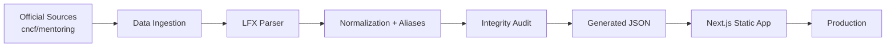

# Contributing to OSSGrid 🌐

Thanks for contributing to OSSGrid.

OSSGrid is maintained with a simple rule:

> **If you claim an issue, own it. Communicate early, ship it properly, and don't leave other contributors blocked.**

Please read this before asking for or starting an issue.

---

## Contributor Rules

### 1. Claim only what you can finish

Do not ask to be assigned multiple issues just to reserve them.

Once an issue is assigned to you, you are expected to make meaningful progress and complete it within the **same weekend**, unless the issue itself has a different timeline.

If you are blocked, comment on the issue before the deadline.

### 2. No progress + no communication = unassigned

If there is:

- no meaningful progress,
- no PR,
- and no communication

by the end of the agreed timeline, the issue may be reassigned.

You may also be removed from the **Active Contributors** list.

Previous commits/authorship will never be altered.

### 3. One issue → one focused PR

Do not mix unrelated refactors, formatting changes, UI redesigns, or dependency upgrades into your PR.

Keep the diff focused on the assigned issue.

### 4. Understand the code before changing it

Do not patch generated JSON manually when the source of truth is the ingestion pipeline.

Fix the parser/source/configuration and regenerate the data.

---

# Architecture



OSSGrid follows a **static-first architecture**.

There is no production database for the mentorship dataset.

The basic flow is:

```text
Official Source
      ↓
fetch-lfx-data.ts
      ↓
lfx-parser.ts
      ↓
Normalization / Metadata
      ↓
audit-data.ts
      ↓
public/data/*.json
      ↓
Next.js Build
      ↓
Static Deployment
```

### Important directories

```text
.github/workflows/     CI and automatic data sync
docs/                  Architecture and verification docs
public/data/           Generated datasets
public/logos/          Organization logos

scripts/
├── fetch-lfx-data.ts  Data ingestion
├── audit-data.ts      Integrity checks
├── lfx-source.json    Pinned upstream source
├── org-metadata.json  Curated organization metadata
├── lib/               Parser + normalization logic
└── tests/             Parser/data regression tests

src/
├── app/               Next.js routes
├── components/        UI components
├── hooks/             Client hooks
└── lib/               Types, search and data utilities
```

For deeper architecture details, read:

**[`docs/ARCHITECTURE.md`](./docs/ARCHITECTURE.md)**

---

# Working on an Issue

## Data / parser issue

When fixing parser behavior:

1. Add or update a regression fixture.
2. Reproduce the bug.
3. Fix the parser.
4. Regenerate the dataset.
5. Run the audit.
6. Verify the affected records against the official source.

Do not solve parser bugs by manually editing generated JSON.

---

## Organization metadata

Edit:

```text
scripts/org-metadata.json
```

Then regenerate and validate the dataset.

---

## New upstream cohort

Use the existing ingestion pipeline.

Do not manually copy projects into `projects.json`.

---

# Required Checks

Before opening or updating your PR:

```bash
npm run test:data
npm run audit:data
npm run check:data
npm run lint
npm run build
```

Your PR should not be marked ready until the relevant checks pass.

---

# Data Accuracy

For mentorship data:

**Official upstream sources win.**

Do not guess:

* project names
* mentors
* technologies
* URLs
* cohort information
* organizations
* project status

If information is unavailable, represent it as unavailable rather than inventing it.

When fixing ingestion, make sure an official source record is either:

1. represented correctly in OSSGrid, or
2. intentionally excluded with a documented reason.

---

# Pull Request Guidelines

A good PR should contain:

* **Target the `main` branch**: Always create pull requests targeting **`main`** (do **not** target `develop`).
* a clear title
* reference to the assigned issue
* a short explanation of the fix
* screenshots for UI changes
* source links for data corrections
* tests for parser/data regressions
* no unrelated changes

Use:

```text
Fixes #<issue-number>
```

when the PR fully resolves an issue.

---

# Contributor Status

Being listed as an **Active Contributor** means you are actively helping maintain or improve OSSGrid.

Assignment alone does not count as contribution.

Repeatedly claiming issues without completing them may result in:

* the issue being reassigned
* future assignments being declined
* removal from the Active Contributors list

Consistent contributors who communicate well and ship quality changes will be prioritized for larger issues.

### Active Contributors

| Contributor | GitHub | Role / Focus | Status |
|---|---|---|---|
| Anand Mishra | [@anand24mishra](https://github.com/anand24mishra) | Core / Frontend | Active |
| Mitul Bhatia | [@mitul-bhatia](https://github.com/mitul-bhatia) | Contributor / Frontend | Active |
| Omved Nagre | [@OmvedNagre](https://github.com/OmvedNagre) | Contributor / Frontend | Active |
| Akhilesh Kumar | [@UserAkku](https://github.com/UserAkku) | Contributor | Active |

---

## Need more time?

That's completely fine — communicate.

A simple issue comment is enough:

> Blocked on X. I need until <date>. Current progress: <short update>.

Silence is the problem, not needing extra time.

---

**Build carefully. Verify against the source. Leave the codebase better than you found it. ❤️**

---

# Reviews

Every pull request is reviewed by CodeRabbit against the issue it closes, then approved and merged by a human maintainer.

- Every PR description needs a closing keyword: `Closes #N` (or `Fixes #N` / `Resolves #N`). The `Require linked issue` workflow fails PRs without one; automated `auto/*` data-sync branches are exempt.
- CodeRabbit reviews the PR automatically against that issue's tasks and acceptance criteria, applies labels, and runs five pre-merge checks: linked issue and scope, hero and landing lock, multi-program data-driven copy, design tokens and copy, data provenance and privacy. The configuration lives in `.coderabbit.yaml`; the CodeRabbit GitHub App must be installed on the repository for it to take effect.
- After pushing fixes, comment `@coderabbitai review` for a re-review of the new commits, `@coderabbitai full review` to re-review everything, and `@coderabbitai resolve` once comments are addressed.
- Issues use the forms in `.github/ISSUE_TEMPLATE/` (bug, feature or task, wrong or missing data, new program dashboard). Blank issues are off.
- A human maintainer still approves and merges. CodeRabbit never merges.

---

# Adding a program

1. Add a registry entry in `src/data/programs.ts` with `status: "coming-soon"`, four sourced facts and a `trackingIssueUrl` (open a "new program" issue; a draft lives in `docs/roadmap/<id>.md`). A preview page appears at `/programs/<id>`.
2. Build the pipeline under `scripts/` with a pin file, a raw cache in `scripts/.cache/`, fixtures and tests, an audit wired into `npm run audit:data`, and a scheduled workflow that opens a PR.
3. Add a `ProgramConfig` under `src/lib/explorer/` and a route on `ExplorerShell`, with metadata, JSON-LD breadcrumb, noscript list and sitemap entries like `/gsoc`.
4. Flip the registry entry to `live` with `dashboardPath` and `dataFile`. Header, landing, footer, sitemap and search update on their own; `npm run audit:programs` checks the route and data exist.

## Directory recognition and synchronization

The `/contributors` directory recognizes contributions to OSSGrid itself. Work on indexed third-party projects is recognized by those projects separately. The creator appears in the historical directory with a Creator label and is also credited in the footer; bot accounts are excluded.

`src/data/contributors-history.json` stores verified all-time GitHub contributors. Run `npm run sync:contributors` to refresh it from `rajatrsrivastav/ossgrid` and review the diff. The script follows pagination, preserves historical entries, and leaves the saved file intact if GitHub fails or rate-limits the request. Optional `GITHUB_TOKEN` credentials stay on the server or in the local script environment. Never use a public environment variable for this token.

Maintainers can recognize verified non-commit work in `src/data/contributors.ts`; include evidence of the contribution in the pull request. The website refreshes the saved directory from GitHub through a cached server endpoint and falls back to the checked-in history when unavailable. Inactivity does not remove someone from the historical directory.
