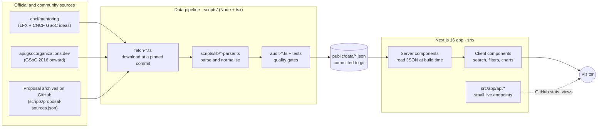
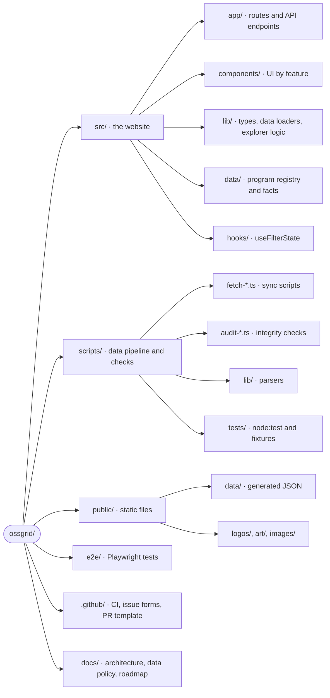

# OSSGrid

> A free, no-login index of open-source mentorship programs. Browse Google Summer of Code and LFX Mentorship organizations, their past projects, mentors and public proposals in one place.

[](https://github.com/rajatrsrivastav/ossgrid/actions/workflows/verify-data.yml)
[](https://github.com/rajatrsrivastav/ossgrid/actions/workflows/sync-data.yml)
[](https://github.com/rajatrsrivastav/ossgrid/actions/workflows/sync-gsoc.yml)

**Live site:** [ossgrid.tech](https://www.ossgrid.tech) · **New here?** Read [CONTRIBUTING.md](./CONTRIBUTING.md) next.

---

## Contents

- [What OSSGrid does](#what-ossgrid-does)
- [How it works](#how-it-works)
- [Quick start](#quick-start)
- [Project structure](#project-structure)
- [Commands](#commands)
- [Tech stack](#tech-stack)
- [Documentation map](#documentation-map)
- [Contributing](#contributing)

---

## What OSSGrid does

Students preparing for a mentorship program usually juggle a dozen GitHub repos, spreadsheets and blog posts. OSSGrid puts the official program data in one searchable site.

| Route | What you find there |
|---|---|
| `/` | Landing page: the programs, what the data shows, the contributor playbook and FAQ |
| `/gsoc` | Every Google Summer of Code organization since 2016, with projects per year and ideas lists |
| `/gsoc/<slug>` | One GSoC organization: projects by year, CNCF ideas, public proposals |
| `/lfx` | Every LFX Mentorship organization since 2019, with projects per term and mentors |
| `/organization/<slug>` | One LFX organization: projects by term, mentors, participation history |
| `/proposals` | Public GSoC proposals indexed from community archives (links only, nothing rehosted) |
| `/guide` | The contributor playbook with a checklist per program |
| `/contribute` | How to contribute to OSSGrid and to the indexed projects |
| `/contributors` | People who have contributed to OSSGrid |
| `/programs/<id>` | Preview pages for programs that are not indexed yet (Outreachy, GSSoC, MLH Fellowship, Summer of Bitcoin) |

OSSGrid never takes applications. Every record links back to its official source.

---

## How it works

OSSGrid is **static-first**. Scripts download the official program data ahead of time, check it, and commit it as JSON. The Next.js app reads that JSON at build time. There is no database.



Scheduled GitHub Actions rerun the pipeline and **open a pull request** when the data changes, so every data update is reviewed like code. The full walkthrough, with more diagrams, is in [docs/ARCHITECTURE.md](./docs/ARCHITECTURE.md).

---

## Quick start

### Prerequisites

| Tool | Version | Check with |
|---|---|---|
| [Node.js](https://nodejs.org/) | 20.9 or newer (CI uses 20 and 22) | `node --version` |
| npm | Comes with Node | `npm --version` |
| [Git](https://git-scm.com/) | Any recent version | `git --version` |

No API keys are needed to run the site locally.

### Run it

```bash
git clone https://github.com/rajatrsrivastav/ossgrid.git
cd ossgrid
npm ci
npm run dev
```

Open [http://localhost:3000](http://localhost:3000). Try `/gsoc`, `/lfx` and `/proposals`.

> `npm ci` installs the exact versions in `package-lock.json`. Use it instead of `npm install` so your setup matches CI.

### Check that everything works

```bash
npm run typecheck   # TypeScript
npm run lint        # ESLint
npm run test:data   # parser and data tests
npm run audit:data  # data integrity checks
```

All four should pass on a fresh clone. If one fails, that is worth an issue.

### Optional: `GITHUB_TOKEN`

A few features call the GitHub API: the contributors page, repository metadata on org pages, and the `sync:*` scripts. They work without a token but GitHub rate-limits anonymous calls. To raise the limit for the dev server, create a `.env.local` file (git-ignored):

```bash
GITHUB_TOKEN=ghp_your_personal_access_token
```

The `scripts/` commands do not read `.env.local`. Pass the token inline instead, for example `GITHUB_TOKEN=ghp_... npm run sync:contributors`.

A token with no scopes is enough. Never commit it, and never rename it with a `NEXT_PUBLIC_` prefix.

---

## Project structure



| Path | What lives there |
|---|---|
| `src/app/` | One folder per route (`page.tsx`), plus `layout.tsx`, `sitemap.ts`, `robots.ts` and `api/` |
| `src/components/` | React components. Feature folders: `explorer/`, `gsoc/`, `lfx/`, `proposals/`, `guide/`, `home/` |
| `src/lib/` | Shared types (`types.ts`), JSON loaders (`gsoc-data.ts`, `proposals-data.ts`, `data.ts`), explorer logic (`explorer/`) |
| `src/data/` | Hand-maintained content: `programs.ts` (the program registry), `program-calendar.json`, `playbook.ts`, `guide.ts`, `resources.json` |
| `scripts/` | Data pipeline (`fetch-*.ts`), checks (`audit-*.ts`, `check-copy.ts`), parsers (`lib/`), tests (`tests/`), pinned sources (`*-source.json`) |
| `public/data/` | Generated JSON. **Do not edit by hand.** Rerun the matching `sync:*` script instead |
| `e2e/` | Playwright smoke and accessibility tests |
| `.github/` | Workflows, issue forms and the PR template |
| `docs/` | [Architecture](./docs/ARCHITECTURE.md), [data verification](./docs/data-verification.md), [roadmap drafts](./docs/roadmap/) |

**Where does it start?** Every page begins at `src/app/<route>/page.tsx`. The shared shell (fonts, theme, footer, analytics) is `src/app/layout.tsx`. The landing page is `src/app/page.tsx`, which renders `src/components/home/HomePageClient.tsx`.

---

## Commands

### Everyday

| Command | What it does |
|---|---|
| `npm run dev` | Start the dev server on port 3000 |
| `npm run build` | Production build (also pre-renders every org page) |
| `npm start` | Serve the production build |
| `npm run typecheck` | TypeScript check, no output files |
| `npm run lint` | ESLint |
| `npm run check:copy` | Fail on hype or filler words in UI copy (rules in [DESIGN.md](./DESIGN.md) §8) |

### Tests

| Command | What it does |
|---|---|
| `npm run test:data` | Parser and dataset tests in `scripts/tests/` (uses Node's built-in test runner) |
| `npm run test:e2e` | Playwright tests in `e2e/` against a production build. Run `npm run build` first |

### Data pipeline

| Command | What it does |
|---|---|
| `npm run audit:data` | Integrity checks for LFX, GSoC, the program registry and proposals |
| `npm run sync:data` / `check:data` | Rebuild the LFX dataset, or verify it is byte-for-byte reproducible |
| `npm run sync:gsoc` / `check:gsoc` | Rebuild or verify the GSoC dataset (`--refresh` moves the CNCF pin, `--year 2026` rebuilds one year) |
| `npm run sync:proposals` / `check:proposals` | Rebuild or verify the proposals index |
| `npm run audit:gsoc` / `audit:programs` | Run one audit on its own |
| `npm run sync:contributors` | Refresh `src/data/contributors-history.json` from GitHub |

The `sync:*` scripts download data. Most contributors never need them.

---

## Tech stack

| Area | Choice |
|---|---|
| Framework | [Next.js 16](https://nextjs.org/) App Router, React 19 |
| Language | TypeScript |
| Styling | [Tailwind CSS v4](https://tailwindcss.com/) with design tokens in `src/app/globals.css` |
| Search | [Fuse.js](https://fusejs.io/), with a prebuilt index for GSoC |
| Charts and motion | [Recharts](https://recharts.org/), [Framer Motion](https://motion.dev/), `d3-force` for the ecosystem graph |
| Icons | [Lucide](https://lucide.dev/) |
| Tests | Node `node:test` via `tsx`, [Playwright](https://playwright.dev/) with axe-core |
| Hosting | Vercel (production), GitHub Pages (pull request previews) |

> **Next.js 16 is newer than most tutorials.** Before changing routing or data loading, read the guides in `node_modules/next/dist/docs/` (see [AGENTS.md](./AGENTS.md)).

---

## Documentation map

| Read this | When you want to |
|---|---|
| [CONTRIBUTING.md](./CONTRIBUTING.md) | Make your first contribution: setup, workflow, checks, rules |
| [CODE_OF_CONDUCT.md](./CODE_OF_CONDUCT.md) | Know how we expect people to treat each other |
| [docs/ARCHITECTURE.md](./docs/ARCHITECTURE.md) | Understand the data pipeline, routes, components and CI |
| [docs/data-verification.md](./docs/data-verification.md) | See how LFX records are checked against `cncf/mentoring` |
| [DESIGN.md](./DESIGN.md) | Follow the design tokens, components and copy rules |
| [PRODUCT.md](./PRODUCT.md) | Understand who OSSGrid is for and what it will not do |
| [docs/roadmap/](./docs/roadmap/) | See draft plans for upcoming programs |

---

## Contributing

Contributions of every size are welcome: fixing a typo, reporting wrong data, adding a test or building a feature.

1. Read [CONTRIBUTING.md](./CONTRIBUTING.md).
2. Pick an [open issue](https://github.com/rajatrsrivastav/ossgrid/issues). [`good first issue`](https://github.com/rajatrsrivastav/ossgrid/issues?q=is%3Aissue+is%3Aopen+label%3A%22good+first+issue%22) is the best place to start.
3. Comment `/assign` on the issue and wait to be assigned.
4. Fork, branch, make one focused change, and open a pull request against `main` with `Closes #<issue>` in the description.

Found a problem? Use the [issue forms](https://github.com/rajatrsrivastav/ossgrid/issues/new/choose).

---

## Data attribution

LFX and CNCF GSoC data comes from [`cncf/mentoring`](https://github.com/cncf/mentoring). GSoC organization data comes from [gsocorganizations.dev](https://www.gsocorganizations.dev) and the [GSoC archive](https://summerofcode.withgoogle.com/archive). Proposals are linked from the archives listed in `scripts/proposal-sources.json`, under each archive's own license.

Google Summer of Code, Google, LFX, the Linux Foundation and CNCF are trademarks of their owners. OSSGrid is a community project and is not affiliated with them.

Built by [Rajat Srivastav](https://x.com/rajatrsrivastav) and [contributors](https://www.ossgrid.tech/contributors).
