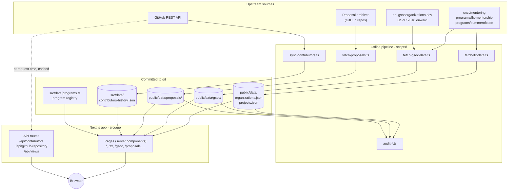
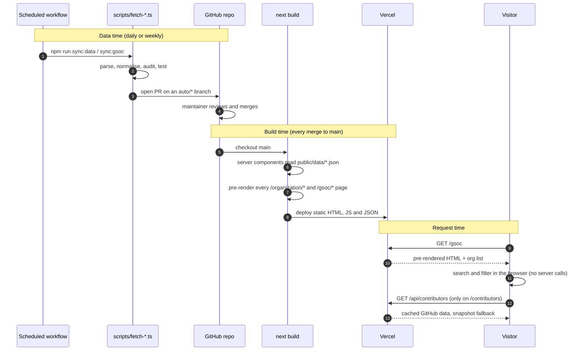
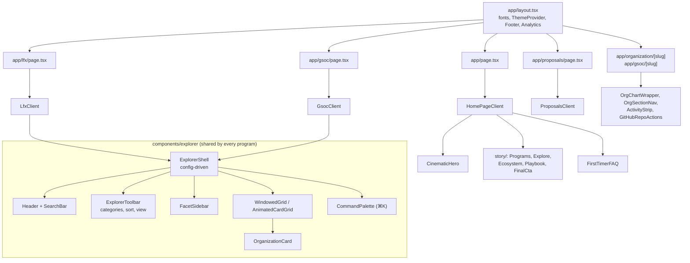
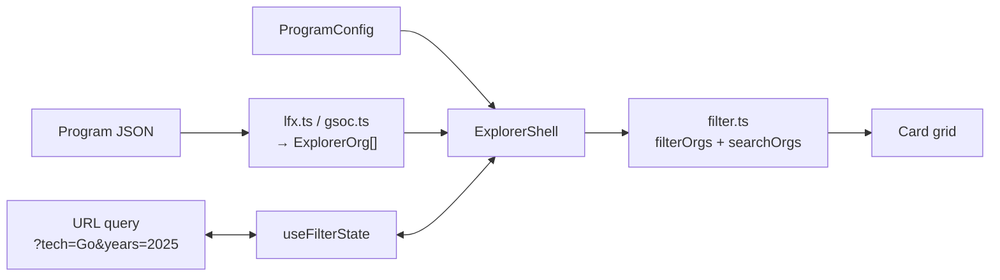
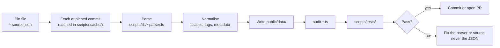
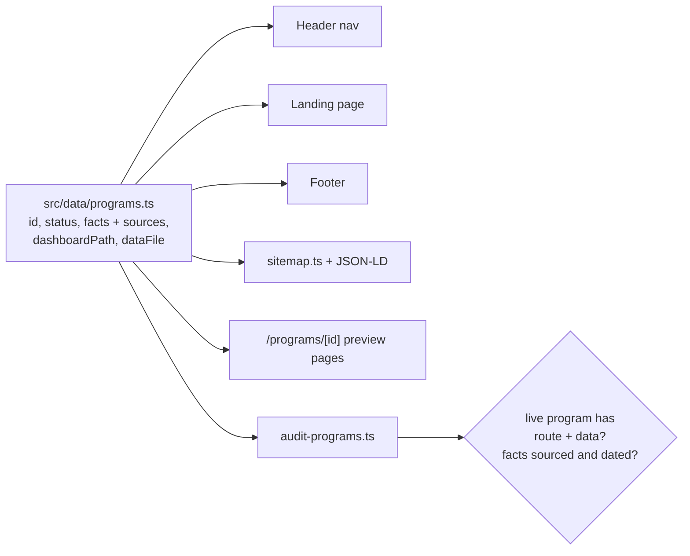
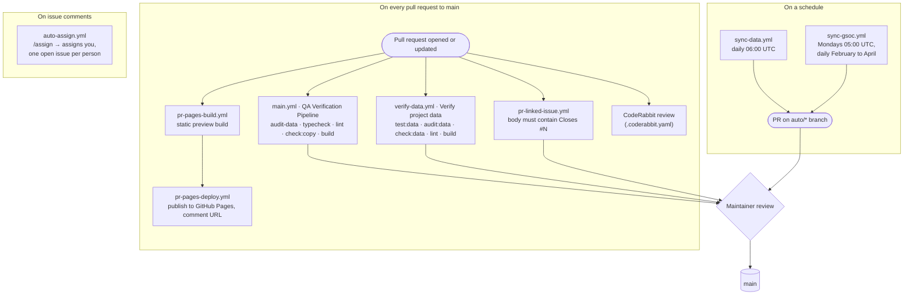

# OSSGrid architecture

This document explains how OSSGrid is put together: where the data comes from, how it becomes a website, and how changes are checked. Read [README.md](../README.md) first for setup.

---

## Contents

1. [Design principles](#1-design-principles)
2. [System overview](#2-system-overview)
3. [What runs when](#3-what-runs-when)
4. [Frontend](#4-frontend)
5. [Data pipelines](#5-data-pipelines)
6. [Data files](#6-data-files)
7. [Program registry](#7-program-registry)
8. [CI and automation](#8-ci-and-automation)
9. [Testing](#9-testing)
10. [Where to make common changes](#10-where-to-make-common-changes)

---

## 1. Design principles

1. **Static first.** Program data is compiled into JSON under `public/data/` and committed. Pages read it at build time. There is no database, so the site stays fast and keeps working when an upstream API is down.
2. **Reproducible data.** Each pipeline downloads its sources at a pinned Git commit and records where every record came from. Running a `check:*` script rebuilds the data and fails if a single byte differs.
3. **Quality gates before merge.** Parsers have regression fixtures, audits reject malformed records, and scheduled syncs open pull requests instead of pushing to `main`.
4. **One registry for programs.** `src/data/programs.ts` lists every program. Navigation, landing page, sitemap and search read from it.
5. **Privacy.** Mentor emails may appear in source files. They are never written to `public/` or shown in the UI.

---

## 2. System overview

Three things to notice:

- **The pipeline and the website are separate.** You can work on the UI without ever running a `sync:*` script.
- **Almost everything is pre-rendered.** Only the three `/api/*` routes do work while a visitor is on the site.
- **Data changes arrive as pull requests,** opened by scheduled workflows (see [section 8](#8-ci-and-automation)).

---

## 3. What runs when

| When | What runs | Where |
|---|---|---|
| Data time | Fetch, parse, audit, test, open PR | GitHub Actions or your terminal |
| Build time | Read JSON with `fs`, render pages, `generateStaticParams()` for org pages | `npm run build`, Vercel |
| Request time | Search and filters (client), three API routes (server) | Browser, Vercel functions |

---

## 4. Frontend

Built with **Next.js 16 (App Router)**, **React 19**, **Tailwind CSS v4** and **Framer Motion**.

> Next.js 16 has breaking changes compared to older tutorials. Check `node_modules/next/dist/docs/` before changing routing or data loading.

### 4.1 Routes

| Route | Entry file | Renders | Data |
|---|---|---|---|
| `/` | `src/app/page.tsx` | `home/HomePageClient.tsx` | `src/lib/home-data.ts` (reads `public/data/`) |
| `/lfx` | `src/app/lfx/page.tsx` | `lfx/LfxClient.tsx` → `ExplorerShell` | `public/data/organizations.json` |
| `/organization/[slug]` | `src/app/organization/[slug]/page.tsx` | Server component | `public/data/organizations.json` |
| `/gsoc` | `src/app/gsoc/page.tsx` | `gsoc/GsocClient.tsx` → `ExplorerShell` | `src/lib/gsoc-data.ts` |
| `/gsoc/[slug]` | `src/app/gsoc/[slug]/page.tsx` | Server component | `src/lib/gsoc-data.ts` (`projects-<year>.json`) |
| `/proposals` | `src/app/proposals/page.tsx` | `proposals/ProposalsClient.tsx` | `src/lib/proposals-data.ts` |
| `/guide` | `src/app/guide/page.tsx` | `guide/ContributionLoop.tsx` | `src/data/guide.ts`, `src/data/programs.ts` |
| `/contribute` | `src/app/contribute/page.tsx` | Server component | `src/data/contributors.ts`, `src/lib/github-repos.ts` |
| `/contributors` | `src/app/contributors/page.tsx` | `ContributorsClient.tsx` | `/api/contributors` |
| `/programs/[id]` | `src/app/programs/[id]/page.tsx` | Server component | `src/data/programs.ts` |

Every route also has metadata, JSON-LD and, for most, an `opengraph-image.tsx`. `src/app/sitemap.ts` lists all of them.

### 4.2 Component tree

### 4.3 The explorer shell

`/lfx` and `/gsoc` share one component, `src/components/explorer/ExplorerShell.tsx`. Each program passes a `ProgramConfig` (`src/lib/explorer/types.ts`) that describes:

- facets (year, category, technology, size) with their URL keys and match rules,
- quick filters, sort options and category tabs,
- search keys and attribution text,
- performance switches: search debounce, when to window the grid, whether cards animate.

Each program converts its own data to a common `ExplorerOrg` shape in `src/lib/explorer/lfx.ts` and `src/lib/explorer/gsoc.ts`. Filtering and Fuse.js search live in `src/lib/explorer/filter.ts`.

`src/hooks/useFilterState.ts` keeps filters in the URL with `history.replaceState`, so any filtered view can be shared as a link. GSoC ships a prebuilt Fuse index (`public/data/gsoc/search-index.json`) so the browser does not have to build one for hundreds of organizations.

### 4.4 Server-side pieces

| File | Purpose |
|---|---|
| `src/app/api/contributors/route.ts` | Merges `src/data/contributors-history.json` with live GitHub data. Cached for an hour. Falls back to the snapshot on error |
| `src/app/api/github-repository/route.ts` | Fetches repository metadata (issues enabled, contributing guide) for org pages. Cached for a day |
| `src/app/api/views/route.ts` | Reads or increments the footer view counter through an external counter service |
| `src/proxy.ts` | Rate-limits `/api/*` and `/organization/*`, and validates org slugs |

These are the only parts that need a server. GitHub Pages previews do not run them (see [CONTRIBUTING.md](../CONTRIBUTING.md#pull-request-previews)).

### 4.5 Styling

Design tokens (colours, radii, spacing, type) live in `src/app/globals.css`. Components use token classes such as `.card`, `.btn-primary` and `.chip` instead of one-off colours. The rules are in [DESIGN.md](../DESIGN.md), and `npm run check:copy` enforces the copy rules.

---

## 5. Data pipelines

All pipelines live in `scripts/` and run with Node and `tsx`. They share the same shape:

| Pipeline | Script | Sources | Pin file | Output |
|---|---|---|---|---|
| LFX | `scripts/fetch-lfx-data.ts` | `cncf/mentoring/programs/lfx-mentorship` | `scripts/lfx-source.json` | `public/data/organizations.json`, `projects.json`, `source-coverage.json` |
| GSoC | `scripts/fetch-gsoc-data.ts` | `api.gsocorganizations.dev`, `cncf/mentoring/programs/summerofcode` | `scripts/gsoc-cncf-source.json` | `public/data/gsoc/` |
| Proposals | `scripts/fetch-proposals.ts` | GitHub Trees API over the repos in `scripts/proposal-sources.json` | `revision` per source | `public/data/proposals/` |
| Contributors | `scripts/sync-contributors.ts` | GitHub contributors API | none | `src/data/contributors-history.json` |

Raw downloads are cached in `scripts/.cache/` (git-ignored), so `check:*` can run offline after one fetch.

### 5.1 LFX pipeline in detail

**Pinned sources (`scripts/lfx-source.json`).** Locks a 40-character `revision` of `cncf/mentoring`, the list of tracked cohort files, the expected project count per file and a SHA-256 hash per file.

**Ingestion (`scripts/fetch-lfx-data.ts`).**

1. Downloads each tracked file from GitHub, or reads it from `--source-dir`.
2. Applies source priority. The machine-readable `lfx-export.json` wins, then accepted records (`README.md`, `selected_projects.md`), then `project_ideas.md`. Proposal-only entries keep `"status": "proposed"`.
3. Deduplicates within a cohort. Strong links (LFX portal URLs, issue URLs) match first. Historical title changes are reconciled through `scripts/source-equivalences.json`. Distinct LFX URLs are never merged.

**Parsing (`scripts/lib/lfx-parser.ts`).** Seven years of Markdown styles: H1 to H5 and bold headings, bold or plain field labels, `*` or `-` bullets, mentors as links, `@handles`, obfuscated emails (`AT`/`DOT`) or handle-only (`nameIsHandle: true`).

**Metadata.** `scripts/org-metadata.json` holds each organization's official name, description, website, repository and browsing category. `scripts/lib/org-aliases.ts` maps variant names to a canonical organization ID.

**Audit (`scripts/audit-data.ts`).** Checks required fields, URL hygiene, and that every project maps to an exact source file, line, revision and hash, and back.

The full source policy is in [data-verification.md](./data-verification.md).

### 5.2 GSoC pipeline

- Organizations for every year since 2016 come from `api.gsocorganizations.dev`.
- CNCF's per-year ideas lists are parsed by `scripts/lib/cncf-gsoc-parser.ts` at the commit pinned in `scripts/gsoc-cncf-source.json`. Malformed blocks become warnings, not crashes.
- Organizations renamed across years are merged by `scripts/gsoc-org-aliases.json`.
- Technology tags are normalised by `scripts/gsoc-tag-aliases.json` and `scripts/lib/tag-aliases.ts` (for example `golang` becomes `Go`).
- Output: a light organization list, one `projects-<year>.json` per year (read only by org pages), a prebuilt search index and a source-coverage report.
- Flags: `--refresh` moves the CNCF pin to the latest commit, `--year 2026` rebuilds one year, `--check` verifies reproducibility.

### 5.3 Proposals pipeline

- `scripts/proposal-sources.json` lists each archive repo, branch, path pattern, license and pinned revision.
- `scripts/fetch-proposals.ts` reads file trees through the GitHub Trees API. It never clones repos or downloads PDFs.
- `scripts/lib/proposals-parser.ts` has one function per archive layout and matches each file to a GSoC organization.
- Records link to the original file. Nothing is rehosted.

---

## 6. Data files

| File | Contents | Written by |
|---|---|---|
| `public/data/organizations.json` | LFX organizations with nested project summaries | `sync:data` |
| `public/data/projects.json` | Flat list of LFX projects with full provenance | `sync:data` |
| `public/data/source-coverage.json` | Map from each LFX source line to project IDs | `sync:data` |
| `public/data/gsoc/organizations.json` | GSoC organizations, light shape for the grid | `sync:gsoc` |
| `public/data/gsoc/projects-<year>.json` | GSoC projects and CNCF ideas for one year | `sync:gsoc` |
| `public/data/gsoc/search-index.json` | Prebuilt Fuse.js index for `/gsoc` | `sync:gsoc` |
| `public/data/gsoc/source-coverage.json` | GSoC source report | `sync:gsoc` |
| `public/data/proposals/proposals.json` | Proposal records with links to originals | `sync:proposals` |
| `public/data/proposals/by-org.json` | Proposal counts per GSoC organization | `sync:proposals` |
| `public/data/proposals/source-coverage.json` | Proposals source report | `sync:proposals` |
| `src/data/contributors-history.json` | OSSGrid contributor snapshot | `sync:contributors` |

At the time of writing (October 2026) the data holds about 100 LFX organizations with about 950 projects, about 520 GSoC organizations, and about 320 proposal records. Run `npm run audit:data` for current numbers. The UI derives every count from the JSON in `src/lib/stats.ts`, so nothing is hardcoded.

**Hand-maintained files** live in `src/data/`: the program registry (`programs.ts`), dates and stipends with sources (`program-calendar.json`), playbook and guide copy, curated resources and contributor recognition (`contributors.ts`).

---

## 7. Program registry

`src/data/programs.ts` is the single source of truth for which programs exist and what state they are in.

| Status | Meaning | Example |
|---|---|---|
| `live` | Has a dashboard route and a data file | `gsoc`, `lfx` |
| `coming-soon` | Has a preview page at `/programs/<id>` and a tracking issue | `outreachy`, `gssoc`, `mlh-fellowship`, `summer-of-bitcoin` |

`npm run audit:programs` fails when a live program is missing its route or data, or when a fact has no source or date. It warns when a fact is older than 180 days. The steps to add a program are in [CONTRIBUTING.md](../CONTRIBUTING.md#adding-a-program).

---

## 8. CI and automation

| Workflow | Trigger | What it checks or does |
|---|---|---|
| `main.yml` | PR to `main` | `audit-data.ts`, `tsc --noEmit`, `lint`, `check:copy`, `build`; posts a summary comment |
| `verify-data.yml` | Every PR, push to `main` | `test:data`, `audit:data`, `check:data`, `lint`, `build` |
| `pr-linked-issue.yml` | Every PR (except `auto/*` branches and Dependabot) | Description must contain `Closes #N`, `Fixes #N` or `Resolves #N` |
| `pr-pages-build.yml` + `pr-pages-deploy.yml` | PR to `main` | Builds a static preview and posts `https://rajatrsrivastav.github.io/ossgrid/pr-<number>/` |
| `sync-data.yml` | Daily, manual | Refreshes LFX data and opens a PR if it changed |
| `sync-gsoc.yml` | Weekly, daily in GSoC season, manual | Refreshes GSoC data and opens a PR if it changed |
| `auto-assign.yml` | `/assign` comment on an issue | Assigns the commenter if they have no other open assigned issue |

The production site is hosted on Vercel and is built from `main`.

---

## 9. Testing

| Layer | Command | Location | What it covers |
|---|---|---|---|
| Data unit tests | `npm run test:data` | `scripts/tests/*.test.ts` + `fixtures/` | LFX parser, CNCF GSoC parser (2017, 2021, 2022, 2024, malformed), GSoC builder, proposal layouts, contributor merging |
| Data audits | `npm run audit:data` | `scripts/audit-*.ts` | Schema, URLs, provenance, program registry, proposals |
| Reproducibility | `npm run check:data`, `check:gsoc`, `check:proposals` | `scripts/fetch-*.ts --check` | Rebuild equals the committed JSON |
| Types and lint | `npm run typecheck`, `npm run lint` | whole repo | TypeScript and ESLint |
| Copy rules | `npm run check:copy` | `scripts/check-copy.ts` | Banned hype words in UI text |
| Browser | `npm run test:e2e` | `e2e/*.spec.ts` | Smoke tests for main routes at 1440 px and 375 px, axe accessibility, contribution flow |

Unit tests use Node's built-in `node:test`. To add one, copy an existing `test(...)` block in the relevant file and change the input and expected value. Parser bugs should get a new fixture in `scripts/tests/fixtures/`.

`npm run test:e2e` starts `next start` on port 3100, so run `npm run build` first. Screenshot baselines in `e2e/__screenshots__/` are machine-specific.

---

## 10. Where to make common changes

| I want to... | Change this | Then run |
|---|---|---|
| Fix a typo on a page | The component under `src/components/` or the page in `src/app/` | `npm run check:copy`, `npm run lint` |
| Fix wrong LFX data | `scripts/lib/lfx-parser.ts` or `scripts/org-metadata.json`, plus a fixture | `npm run sync:data`, `npm run test:data`, `npm run audit:data` |
| Fix a GSoC tag or org name | `scripts/gsoc-tag-aliases.json` or `scripts/gsoc-org-aliases.json` | `npm run sync:gsoc`, `npm run audit:data` |
| Update a stipend or date | `src/data/program-calendar.json` or `src/data/programs.ts`, with source URL and date | `npm run audit:programs` |
| Add a filter to an explorer | The `ProgramConfig` in `src/lib/explorer/lfx.ts` or `gsoc.ts` | `npm run typecheck`, check in the browser |
| Change colours or spacing | Tokens in `src/app/globals.css` (see `DESIGN.md`) | Check light and dark mode |
| Add a proposal archive | `scripts/proposal-sources.json` and a layout in `scripts/lib/proposals-parser.ts` | `npm run sync:proposals`, `npm run test:data` |

Never edit files in `public/data/` by hand. They are overwritten on the next sync.
